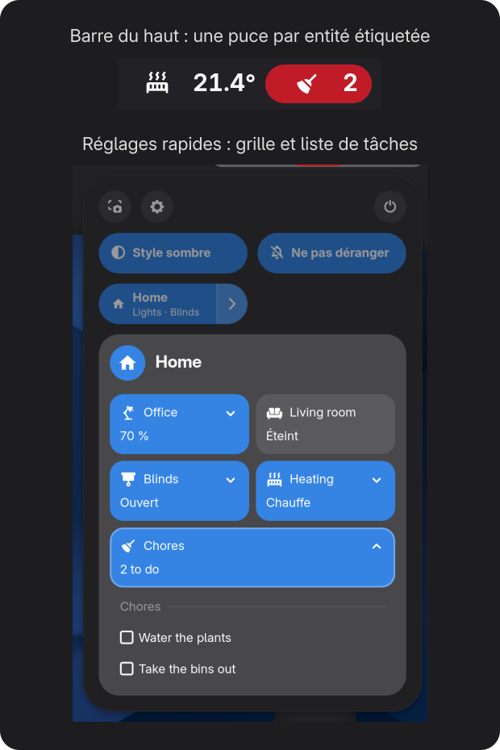
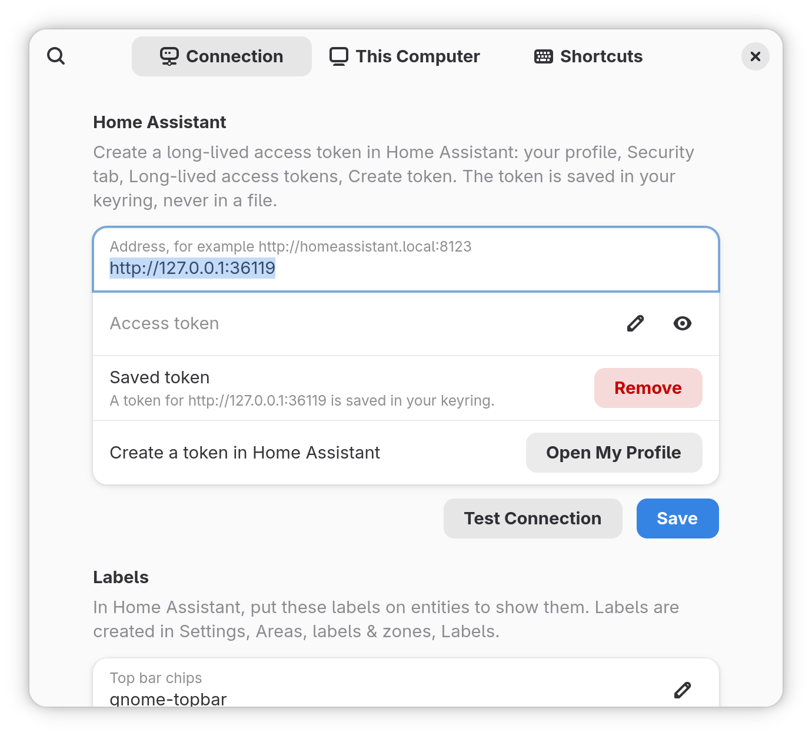

# Home Assistant for GNOME

[](https://github.com/maximeallanic/gnome-home-assistant/actions/workflows/ci.yml)
[](LICENSE)
[](#prérequis)
[](https://github.com/maximeallanic/gnome-home-assistant/releases)

*[English version](README.md)*

**Votre maison Home Assistant dans la barre du haut et les réglages rapides de GNOME, et votre ordinateur comme
appareil Home Assistant.**

Une extension GNOME Shell non officielle. Posez une étiquette sur une entité dans Home Assistant et elle apparaît sur
votre bureau : aucun identifiant d'entité à saisir, pas de YAML pour une première puce, pas d'agent à part, pas de
broker MQTT.

<p align="center">
  
</p>

```sh
curl -fsSL https://raw.githubusercontent.com/maximeallanic/gnome-home-assistant/main/install.sh | bash
```

GNOME Shell 51 uniquement. Sous Wayland, fermez puis rouvrez la session une fois, puis suivez la notification
« Connecter Home Assistant » ([mise en route](#mise-en-route)).

## Pourquoi cette extension

- **Vous choisissez dans Home Assistant, pas dans une liste de réglages.** Les puces et la grille suivent les
  étiquettes posées sur les entités dans Home Assistant. Ajoutez ou retirez une étiquette là-bas et le bureau suit ;
  rien de votre maison n'est stocké dans l'extension.
- **Elle s'installe là où GNOME range déjà les commandes rapides.** Les puces se placent à côté des icônes d'état du
  système ; lumières, volets, scripts, curseurs et listes de tâches vont dans les réglages rapides, avec des
  raccourcis clavier si vous le souhaitez.
- **L'ordinateur devient un appareil, comme votre téléphone.** Le compagnon facultatif s'enregistre par
  l'intégration `mobile_app` de Home Assistant, depuis GNOME Shell : pas d'application à part à faire tourner, pas de
  broker MQTT à installer. Ses capteurs continuent de remonter quand l'écran est verrouillé.
- **Tout se règle dans une seule fenêtre de préférences.** Adresse, jeton, **Tester la connexion**,
  **Enregistrer**. Le jeton va dans votre trousseau.

La comparaison, en faits :

| | Cette extension | Agents de bureau autonomes |
|---|---|---|
| Où elle tourne | dans GNOME Shell | une application ou un service à part |
| Lien avec Home Assistant | API WebSocket ; `mobile_app` pour le compagnon | [LNXlink](https://github.com/bkbilly/lnxlink) : MQTT. [go-hass-agent](https://github.com/joshuar/go-hass-agent) : `mobile_app`, commandes par MQTT. [HASS.Agent](https://github.com/hass-agent/hass.agent) : MQTT, Windows seulement |
| Commandes sur le bureau | puces, grille des réglages rapides, listes de tâches | selon le projet |
| Plateformes | GNOME Shell 51 | Linux (tout bureau) ou Windows |

Les applications compagnon officielles de Home Assistant existent pour Android, iOS et macOS. Si vous voulez des
capteurs et des commandes sur un autre bureau que GNOME, ou sur une autre version de GNOME, un agent autonome est
aujourd'hui le meilleur choix.

## Ce que vous obtenez

- **L'état d'un coup d'œil.** Chaque entité portant l'étiquette `gnome-topbar` devient une puce dans la barre du haut,
  avec son état et son icône ; ajoutez `gnome-topbar-alert` pour la passer en rouge. Un état vide masque la puce :
  une puce de modèle n'apparaît que lorsqu'elle a quelque chose à dire. [Puces](docs/chips.md) (en anglais).
- **Piloter sans ouvrir de navigateur.** Une entité portant `gnome-grid` décrit une grille de mini-tuiles dans les
  réglages rapides : allumer une lumière, lancer un script, choisir entre plusieurs boutons, régler un curseur
  (luminosité, position d'un volet, nombre), cocher des tâches. [Grille](docs/grid.md) (en anglais).
- **Des raccourcis clavier** pour n'importe quelle mini-tuile ou choix, avec le retour visuel du Shell.
- **Votre langue.** Les textes de l'extension sont traduits (anglais et français pour l'instant) ; les mots d'état
  (`on`, `open`, `heat`…) viennent des traductions de Home Assistant dans la langue du bureau ; les nombres suivent
  votre locale.
- **Des automatisations qui connaissent votre ordinateur (facultatif).** Jusqu'à 25 capteurs (verrouillé, actif,
  écran, volume, luminosité, batterie, média, processeur…), 14 commandes que Home Assistant peut envoyer (volume,
  luminosité, verrouillage, extinction de l'écran, style sombre, touches média, ouvrir une page web, lancer une
  application) et des notifications avec boutons. Les préférences génèrent le paquet Home Assistant correspondant.
  [Compagnon](docs/companion.md) (en anglais).

<p align="center">
  
</p>

Toutes les images sont des captures réelles d'un GNOME Shell 51 imbriqué, connecté à un faux Home Assistant avec une
maison inventée ([comment elles sont prises](screenshots/README.md)) ; l'image du haut en assemble deux, sans
retouche. Les textes écrits par les modèles de la démo restent en anglais ; les mots d'état (« Éteint », « Ouvert »,
« Chauffe ») viennent des traductions de Home Assistant. La capture des préférences ci-dessus est en anglais.

## Prérequis

- GNOME Shell **51** (seule version déclarée et testée).
- L'introspection GObject de libsecret et libsoup 3, et un trousseau (présents sur un bureau GNOME ordinaire ;
  l'installateur vérifie et donne les noms de paquets pour Debian/Ubuntu, Fedora, Arch et openSUSE).
- Home Assistant joignable depuis l'ordinateur, et un jeton d'accès longue durée.

## Installation

```sh
curl -fsSL https://raw.githubusercontent.com/maximeallanic/gnome-home-assistant/main/install.sh | bash
```

Le script télécharge la version épinglée, la vérifie avec `SHA256SUMS`, l'installe pour votre utilisateur seulement
et l'active. Avec `bash -s -- --install-deps`, il propose d'installer les paquets système manquants (il demande
d'abord). **Sous Wayland, fermez puis rouvrez la session une fois** après la première installation. Autres méthodes
(clone, zip, options) : [docs/installation.md](docs/installation.md).

## Mise en route

Sur le bureau :

1. La notification « Connecter Home Assistant » ouvre les préférences (ou lancez
   `gnome-extensions prefs home-assistant@maximeallanic.github.io`).
2. Saisissez l'adresse de Home Assistant, collez un jeton d'accès longue durée (votre profil Home Assistant, onglet
   **Sécurité** ; le bouton **Ouvrir mon profil** y mène), appuyez sur **Tester la connexion**, puis
   **Enregistrer**.

Dans Home Assistant :

3. Créez l'étiquette `gnome-topbar` (**Paramètres > Pièces, étiquettes et zones > Étiquettes**) et posez-la sur une
   entité, par exemple un capteur de température. Sa puce apparaît dans la barre du haut.
4. Pour la grille des réglages rapides et des textes à vous, partez du paquet d'exemple
   [`ha/packages/gnome_topbar.example.yaml`](ha/packages/gnome_topbar.example.yaml).
5. Facultatif : dans la page **Cet ordinateur** des préférences, activez **Enregistrer cet ordinateur**, puis copiez
   le paquet généré dans Home Assistant pour obtenir interrupteurs, nombres et boutons pour les commandes.

Pas à pas : [docs/home-assistant-setup.md](docs/home-assistant-setup.md) (en anglais).

## Confidentialité et sécurité

- **Ne parle qu'à votre Home Assistant**, plus `cdn.jsdelivr.net` la première fois qu'une icône `mdi:` s'affiche (un
  interrupteur le désactive). Aucune statistique d'usage, aucun autre serveur.
- **Le jeton est dans le trousseau** (libsecret), jamais dans un fichier, GSettings ou le journal. Un utilisateur
  Home Assistant dédié, non administrateur, suffit si vous n'utilisez pas le compagnon.
- **Home Assistant ne peut pas lancer n'importe quelle commande sur votre ordinateur.** Seules les 14 commandes
  listées sont acceptées, avec des paramètres vérifiés ; ouvrir une page web et lancer une application sont refusés
  quand l'écran est verrouillé.
- **Sur l'écran de verrouillage**, puces et grille sont masquées et rien n'est cliquable ; seul le compagnon continue
  de fonctionner.
- **Un jeton refusé arrête les tentatives**, pour que le bureau ne déclenche pas le bannissement d'IP de Home
  Assistant.
- `uninstall.sh --purge` supprime le jeton, les réglages, le fichier d'enregistrement et le cache d'icônes.

Tout ce que le compagnon envoie, et à qui : [Confidentialité et sécurité](docs/privacy-security.md) (en anglais).

## Limites

La version 0.1.0 est une préversion. Ce qu'elle ne fait pas encore :

- **GNOME Shell 51 uniquement.** L'extension s'appuie sur des éléments internes des réglages rapides qui changent
  d'une version à l'autre, et GNOME refuse de l'activer sur une autre version. Les retours d'autres versions sont
  bienvenus.
- **Pas encore sur extensions.gnome.org** ; installez-la avec le script ci-dessus ou depuis le zip de la version.
- **Le capteur et la commande Caffeine demandent l'extension
  [Caffeine](https://extensions.gnome.org/extension/517/caffeine/).** Les autres capteurs ne sont déclarés que si le
  matériel ou le service existe (batterie, rétroéclairage du clavier…).
- **Paquets des distributions :** seuls les noms Debian ont été vérifiés sur un vrai système ; ceux de Fedora, Arch
  et openSUSE viennent de l'index de paquets de chaque distribution. Seules des sessions Wayland ont été essayées.
- **Une seule grille**, décrite par un capteur de modèle (YAML). Les puces se passent de YAML.
- **Les icônes** sont uniquement des noms `mdi:`, téléchargées une fois depuis le CDN jsDelivr sauf si vous le
  désactivez.
- **Testée** par des tests unitaires et d'intégration contre un faux Home Assistant et dans un GNOME Shell 51
  imbriqué sous Debian testing ; pas encore par beaucoup de monde sur beaucoup de machines. Plus de détails dans le
  [journal des modifications](CHANGELOG.md).

## Questions fréquentes

**Est-ce un projet officiel Home Assistant ?** Non. C'est une extension indépendante qui utilise les API WebSocket et
REST publiques de Home Assistant et son intégration `mobile_app`.

**Faut-il écrire du YAML ?** Pas pour les puces : une étiquette sur une entité existante suffit. Oui pour la grille
(un capteur de modèle ; le paquet d'exemple sert de point de départ). Le paquet du compagnon est généré pour vous.

**Est-ce que ça ralentit GNOME ?** L'extension garde une seule connexion WebSocket ouverte et ne reçoit que l'état des
entités qu'elle affiche. Le compagnon relève processeur, mémoire et capteurs matériels toutes les 30 secondes et
n'envoie une valeur que si elle change.

**Accès à distance ou proxy inverse ?** Toute adresse qui sert l'API de Home Assistant en `http(s)://` avec le
WebSocket fonctionne, y compris une adresse distante Nabu Casa. Utilisez `https://` sur un réseau que vous ne
maîtrisez pas.

**Pourquoi tourne-t-elle sur l'écran de verrouillage ?** Uniquement pour le compagnon : les capteurs « Verrouillé »
et « Actif » et les commandes autorisées en verrouillage doivent continuer de fonctionner.

**GNOME 50 ou 52 ?** Non déclarées, non testées. Modifier `shell-version` peut marcher mais n'est pas pris en charge.

Plus : [FAQ](docs/faq.md) · [Dépannage](docs/troubleshooting.md) (en anglais).

## Vérifier, mettre à jour, désinstaller

```sh
curl -fsSL https://raw.githubusercontent.com/maximeallanic/gnome-home-assistant/main/verify.sh | bash             # diagnostic, sans rien modifier
curl -fsSL https://raw.githubusercontent.com/maximeallanic/gnome-home-assistant/main/install.sh | bash            # mise à jour
curl -fsSL https://raw.githubusercontent.com/maximeallanic/gnome-home-assistant/main/uninstall.sh | bash -s -- --purge
```

Depuis un clone : `./verify.sh [--online]`, `./install.sh`, `./uninstall.sh [--purge]`. `--purge` supprime aussi le
jeton, les réglages et l'enregistrement du compagnon ; supprimez vous-même l'appareil dans Home Assistant.

## Documentation

La documentation détaillée est en anglais : [docs/index.md](docs/index.md).

## Essayez-la, et dites-nous

Vous utilisez Home Assistant et GNOME 51 ? Installez-la, étiquetez une entité, et
[ouvrez un ticket](https://github.com/maximeallanic/gnome-home-assistant/issues) pour dire ce qui a marché et ce qui
a coincé : votre distribution, votre matériel et votre configuration GNOME sont précisément ce que les tests ne
couvrent pas. Suivez ou étoilez le dépôt pour savoir quand elle arrive sur extensions.gnome.org. Les traductions sont
bienvenues : [docs/development.md#translations](docs/development.md#translations). Voir aussi
[CONTRIBUTING.md](CONTRIBUTING.md), [SUPPORT.md](SUPPORT.md) et [SECURITY.md](SECURITY.md).

## Licence et marques

MIT, voir [LICENSE](LICENSE). Contenus tiers (Material Design Icons) et marques : [NOTICE.md](NOTICE.md).

Ce projet communautaire n'est pas officiel : il n'est ni affilié à Home Assistant ou à l'Open Home Foundation, ni
approuvé ou soutenu par eux. « Home Assistant » est une marque de l'Open Home Foundation, utilisée ici uniquement pour
nommer le logiciel auquel l'extension se connecte.
