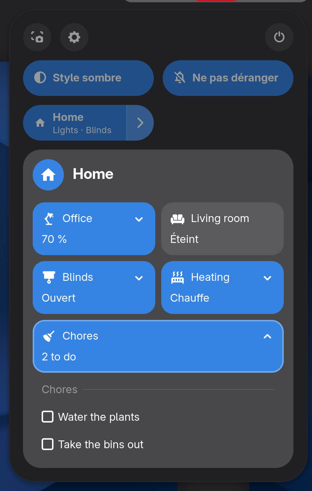
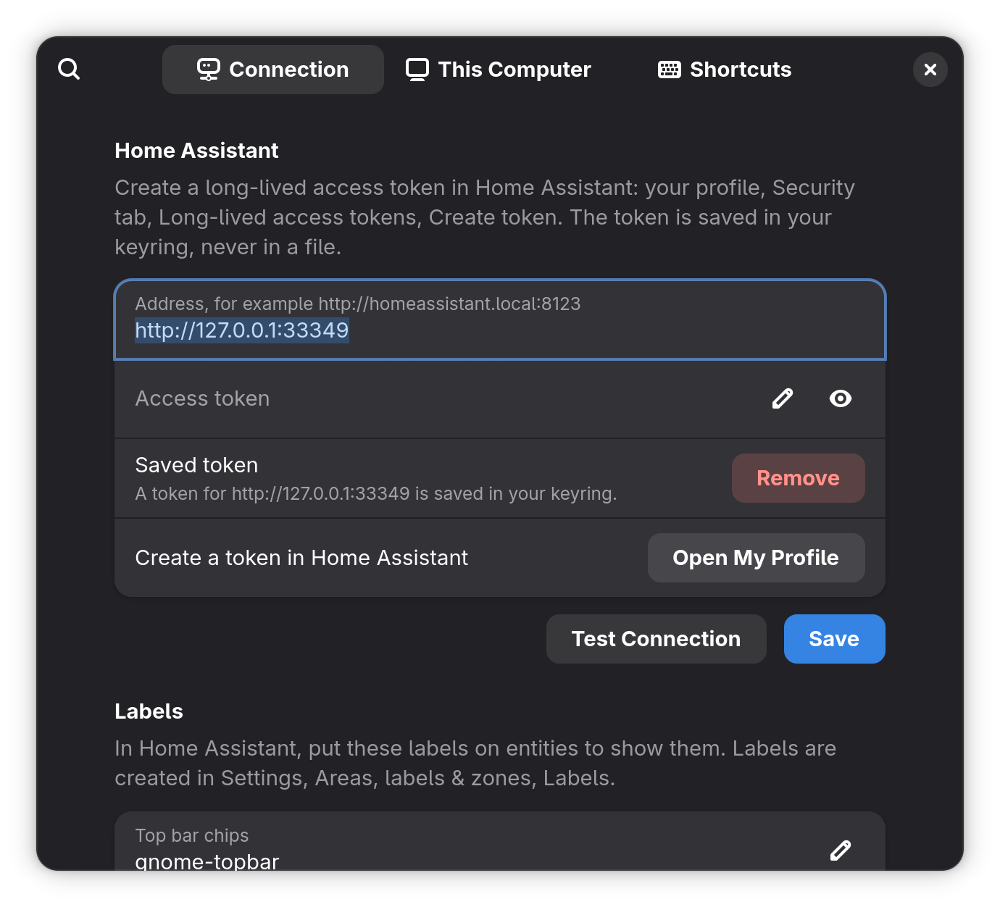

# Home Assistant for GNOME

[](https://github.com/maximeallanic/gnome-home-assistant/actions/workflows/ci.yml)
[](LICENSE)
[](#prérequis)
[](https://github.com/maximeallanic/gnome-home-assistant/releases)

*[English version](README.md)*

Une extension GNOME Shell qui met Home Assistant dans la barre du haut et dans les réglages rapides. Vous choisissez
ce qui s'affiche en posant une étiquette (label) sur des entités dans Home Assistant ; rien de votre maison n'est
écrit dans l'extension. En option, elle enregistre l'ordinateur comme appareil Home Assistant, comme le font les
applications pour téléphone.

<p align="center">
  
</p>
<p align="center">
  
  
</p>

Les captures sont réelles : un GNOME Shell 51 imbriqué connecté à un faux Home Assistant avec une maison inventée
([comment elles sont prises](screenshots/README.md)). Les textes écrits par les modèles de la démo restent en
anglais ; les mots d'état (« Éteint », « Ouvert », « Chauffe ») viennent des traductions de Home Assistant.

## Fonctions

- **Puces dans la barre du haut.** Chaque entité portant l'étiquette `gnome-topbar` devient une puce avec son état
  et son icône. Ajoutez `gnome-topbar-alert` pour l'afficher en alerte. Un état vide masque la puce : un modèle peut
  ainsi n'afficher quelque chose que lorsque c'est utile.
- **Grille dans les réglages rapides.** Une entité portant `gnome-grid` décrit une grille de mini-tuiles : allumer
  une lumière, lancer un script, choisir entre plusieurs boutons, régler un curseur (luminosité, position d'un
  volet, nombre), cocher des tâches. [Contrat](docs/grid.md) (en anglais).
- **Raccourcis clavier** pour n'importe quelle mini-tuile ou choix, avec le retour visuel du Shell.
- **Votre langue.** Les textes de l'extension passent par gettext (anglais, français pour l'instant) ; les mots
  d'état (`on`, `open`, `heat`…) utilisent les traductions de Home Assistant dans la langue du bureau ; les nombres
  suivent votre locale.
- **Compagnon (facultatif).** Enregistre l'ordinateur via `mobile_app` : jusqu'à 25 capteurs (verrouillé, actif,
  écran, volume, luminosité, batterie, média, processeur…), 14 commandes que Home Assistant peut envoyer (volume,
  luminosité, verrouillage, extinction de l'écran, style sombre, touches média, ouvrir une page web, lancer une
  application) et des notifications avec boutons. Les préférences génèrent le paquet Home Assistant correspondant.
  [Détails](docs/companion.md).
- **Jeton dans le trousseau**, jamais dans un fichier. [Confidentialité et sécurité](docs/privacy-security.md).

## Prérequis

- GNOME Shell **51** (seule version déclarée et testée).
- L'introspection GObject de libsecret et libsoup 3, et un trousseau (présents sur un bureau GNOME ordinaire ;
  l'installateur vérifie et donne les noms de paquets pour Debian/Ubuntu, Fedora, Arch et openSUSE).
- Home Assistant joignable depuis l'ordinateur, et un jeton d'accès longue durée.

## Installation

```sh
curl -fsSL https://raw.githubusercontent.com/maximeallanic/gnome-home-assistant/main/install.sh | bash
```

Le script télécharge la version épinglée, la vérifie avec `SHA256SUMS`, l'installe pour votre utilisateur seulement
et l'active. Avec `bash -s -- --install-deps`, il propose d'installer les paquets système manquants (il demande
d'abord). **Sous Wayland, fermez puis rouvrez la session une fois** après la première installation. Autres
méthodes (clone, zip, options) : [docs/installation.md](docs/installation.md).

## Mise en route

1. Une notification « Connecter Home Assistant » ouvre les préférences (ou lancez
   `gnome-extensions prefs home-assistant@maximeallanic.github.io`).
2. Saisissez l'adresse de Home Assistant, collez un jeton d'accès longue durée (votre profil Home Assistant, onglet
   **Sécurité**), appuyez sur **Tester la connexion**, puis **Enregistrer**.
3. Dans Home Assistant, créez l'étiquette `gnome-topbar` (**Paramètres > Pièces, étiquettes et zones >
   Étiquettes**) et posez-la sur une entité. Sa puce apparaît dans la barre du haut.
4. Pour la grille et des textes à vous, partez du paquet d'exemple
   [`ha/packages/gnome_topbar.example.yaml`](ha/packages/gnome_topbar.example.yaml).

Pas à pas : [docs/home-assistant-setup.md](docs/home-assistant-setup.md).

## Vérifier, mettre à jour, désinstaller

```sh
curl -fsSL https://raw.githubusercontent.com/maximeallanic/gnome-home-assistant/main/verify.sh | bash             # diagnostic, sans rien modifier
curl -fsSL https://raw.githubusercontent.com/maximeallanic/gnome-home-assistant/main/install.sh | bash            # mise à jour
curl -fsSL https://raw.githubusercontent.com/maximeallanic/gnome-home-assistant/main/uninstall.sh | bash -s -- --purge
```

Depuis un clone : `./verify.sh [--online]`, `./install.sh`, `./uninstall.sh [--purge]`. `--purge` supprime aussi le
jeton, les réglages et l'enregistrement du compagnon ; supprimez vous-même l'appareil dans Home Assistant.

## Documentation

La documentation détaillée est en anglais : [docs/index.md](docs/index.md).

## État

Version 0.1.0, préversion. Testée par des tests unitaires et d'intégration contre un faux Home Assistant, et dans un
GNOME Shell 51 imbriqué sous Debian testing. Pas encore sur extensions.gnome.org. Les limites connues sont dans le
[journal des modifications](CHANGELOG.md).

## Contribuer, aide, sécurité

Voir [CONTRIBUTING.md](CONTRIBUTING.md), [SUPPORT.md](SUPPORT.md) et [SECURITY.md](SECURITY.md). Les traductions
sont bienvenues : [docs/development.md#translations](docs/development.md#translations).

## Licence

MIT, voir [LICENSE](LICENSE). Contenus tiers (Material Design Icons) et marques : [NOTICE.md](NOTICE.md). Sans lien
avec Home Assistant ni l'Open Home Foundation.
