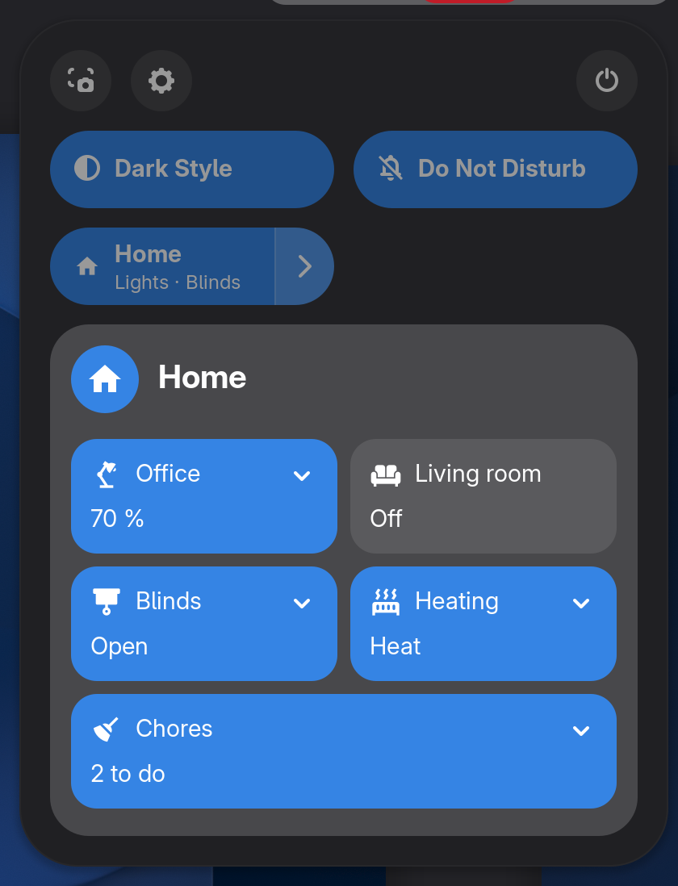
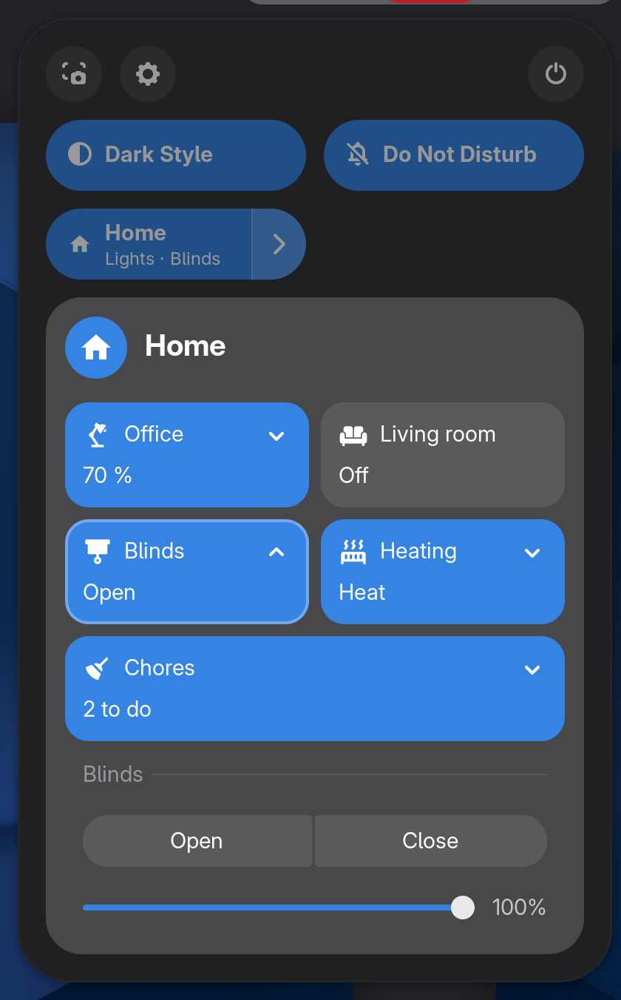

# Home Assistant for GNOME

[](https://github.com/maximeallanic/gnome-home-assistant/actions/workflows/ci.yml)
[](LICENSE)
[](#requirements)
[](https://github.com/maximeallanic/gnome-home-assistant/releases)

*[Version française](README.fr.md)*

A GNOME Shell extension that puts Home Assistant in the top bar and in Quick Settings. You choose what appears by
putting a label on entities in Home Assistant; nothing about your home is written in the extension. Optionally, it
registers the computer as a Home Assistant device, like the phone apps do.

<p align="center">
  
</p>
<p align="center">
  
  
</p>
<p align="center">
  
</p>

Screenshots are real: a nested GNOME Shell 51 connected to a fake Home Assistant with a made-up home
([how they were taken](screenshots/README.md)). More in [`screenshots/`](screenshots).

## Features

- **Top bar chips.** Every entity carrying the `gnome-topbar` label becomes a chip with its state and icon. Add
  `gnome-topbar-alert` to draw it as an alert. Empty states hide the chip, so a template can show something only
  when it matters.
- **Quick Settings grid.** One entity carrying `gnome-grid` describes a grid of mini-tiles: toggle a light, run a
  script, pick between choices, drag a slider (brightness, cover position, number), tick to-do items.
  [Contract](docs/grid.md).
- **Keyboard shortcuts** for any mini-tile or choice, with the Shell's on-screen feedback.
- **Your language.** The extension's own text is translated with gettext (English, French so far); state words
  (`on`, `open`, `heat`...) use Home Assistant's own translations for the desktop language; numbers follow your
  locale.
- **Companion (optional).** Registers the computer through `mobile_app`: up to 25 sensors (locked, active, screen,
  volume, brightness, battery, media, CPU...), 14 commands Home Assistant can send (volume, brightness, lock, screen
  off, dark style, media keys, open a web page, launch an app), and notifications with action buttons. The
  preferences generate the matching Home Assistant package. [Details](docs/companion.md).
- **Token in the keyring**, never in a file. [Privacy and security](docs/privacy-security.md).

## Requirements

- GNOME Shell **51** (the only version declared and tested).
- libsecret and libsoup 3 GObject introspection, and a keyring (present on a normal GNOME desktop; the installer
  checks and tells you the package names for Debian/Ubuntu, Fedora, Arch and openSUSE).
- Home Assistant reachable from the computer, and a long-lived access token.

## Install

```sh
curl -fsSL https://raw.githubusercontent.com/maximeallanic/gnome-home-assistant/main/install.sh | bash
```

This downloads the pinned release, checks it against `SHA256SUMS`, installs it for your user only and enables it.
Add `bash -s -- --install-deps` to let it install missing system packages (it asks first). **On Wayland, log out and
back in once** after the first install. Other ways (clone, zip, options): [docs/installation.md](docs/installation.md).

## Set up

1. A notification "Connect Home Assistant" opens the preferences (or run
   `gnome-extensions prefs home-assistant@maximeallanic.github.io`).
2. Enter the Home Assistant address, paste a long-lived access token (your Home Assistant profile, **Security** tab),
   press **Test Connection**, then **Save**.
3. In Home Assistant, create the label `gnome-topbar` (**Settings > Areas, labels & zones > Labels**) and put it on
   an entity. Its chip appears in the top bar.
4. For the grid and texts of your own, start from the example package
   [`ha/packages/gnome_topbar.example.yaml`](ha/packages/gnome_topbar.example.yaml).

Step by step: [docs/home-assistant-setup.md](docs/home-assistant-setup.md).

## Check, update, uninstall

```sh
curl -fsSL https://raw.githubusercontent.com/maximeallanic/gnome-home-assistant/main/verify.sh | bash             # read-only diagnosis
curl -fsSL https://raw.githubusercontent.com/maximeallanic/gnome-home-assistant/main/install.sh | bash            # update
curl -fsSL https://raw.githubusercontent.com/maximeallanic/gnome-home-assistant/main/uninstall.sh | bash -s -- --purge
```

From a clone: `./verify.sh [--online]`, `./install.sh`, `./uninstall.sh [--purge]`. `--purge` also removes the token,
the settings and the companion registration; delete the device in Home Assistant yourself.

## Documentation

[Installation](docs/installation.md) ·
[Home Assistant setup](docs/home-assistant-setup.md) ·
[Chips](docs/chips.md) ·
[Grid](docs/grid.md) ·
[Companion](docs/companion.md) ·
[Configuration](docs/configuration.md) ·
[Privacy and security](docs/privacy-security.md) ·
[Theming](docs/theming.md) ·
[Troubleshooting](docs/troubleshooting.md) ·
[FAQ](docs/faq.md) ·
[Development](docs/development.md) ·
[extensions.gnome.org](docs/extensions-gnome-org.md)

## Status

Version 0.1.0, a pre-release. Tested with unit and integration tests against a fake Home Assistant, and in a nested
GNOME Shell 51 on Debian testing. Not yet on extensions.gnome.org. Known limitations are listed in the
[changelog](CHANGELOG.md).

## Contributing, support, security

See [CONTRIBUTING.md](CONTRIBUTING.md), [SUPPORT.md](SUPPORT.md) and [SECURITY.md](SECURITY.md). Translations are
welcome: [docs/development.md#translations](docs/development.md#translations).

## Licence

MIT, see [LICENSE](LICENSE). Third-party material (Material Design Icons) and trademarks: [NOTICE.md](NOTICE.md).
Not affiliated with Home Assistant or the Open Home Foundation.
