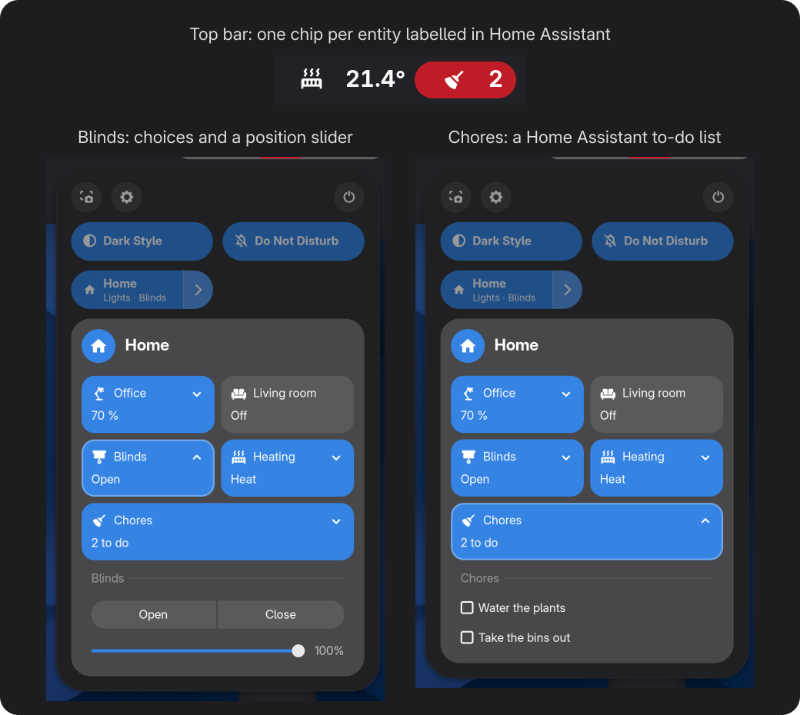

# Home Assistant for GNOME

[](https://github.com/maximeallanic/gnome-home-assistant/actions/workflows/ci.yml)
[](LICENSE)
[](#requirements)
[](https://github.com/maximeallanic/gnome-home-assistant/releases)

*[Version française](README.fr.md)*

**Your Home Assistant home in the GNOME top bar and Quick Settings, and your computer as a Home Assistant device.**

An unofficial GNOME Shell extension. Put a label on an entity in Home Assistant and it shows up on your desktop: no
entity ids to type, no YAML for a first chip, no separate agent, no MQTT broker.

<p align="center">
  
</p>

```sh
curl -fsSL https://raw.githubusercontent.com/maximeallanic/gnome-home-assistant/main/install.sh | bash
```

GNOME Shell 51 only. On Wayland, log out and back in once, then follow the "Connect Home Assistant" notification
([set up](#set-up)).

## Why this extension

- **You decide in Home Assistant, not in a settings list.** Chips and the grid follow labels you put on entities in
  Home Assistant. Add or remove a label there and the desktop follows; nothing about your home is stored in the
  extension.
- **It lives where GNOME already puts quick controls.** Chips sit next to the system status icons; lights, blinds,
  scripts, sliders and to-do lists sit in Quick Settings, with optional keyboard shortcuts.
- **The computer becomes a device, the way your phone does.** The optional companion registers through Home
  Assistant's own `mobile_app` integration, from inside GNOME Shell: no separate application to run, no MQTT broker
  to set up. Its sensors keep reporting while the screen is locked.
- **Set up from one preferences window.** Address, token, **Test Connection**, **Save**. The token goes to your
  keyring.

How it compares, in facts:

| | This extension | Standalone desktop agents |
|---|---|---|
| Where it runs | inside GNOME Shell | a separate application or service |
| Link to Home Assistant | WebSocket API; `mobile_app` for the companion | [LNXlink](https://github.com/bkbilly/lnxlink): MQTT. [go-hass-agent](https://github.com/joshuar/go-hass-agent): `mobile_app`, controls through MQTT. [HASS.Agent](https://github.com/hass-agent/hass.agent): MQTT, Windows only |
| Controls on the desktop | top bar chips, Quick Settings grid, to-do lists | depends on the project |
| Platforms | GNOME Shell 51 | Linux (any desktop) or Windows |

The official Home Assistant companion apps cover Android, iOS and macOS. If you want desktop sensors and commands on
another desktop than GNOME, or on another GNOME version, a standalone agent is the better fit today.

## What you get

- **State at a glance.** Every entity labelled `gnome-topbar` becomes a chip in the top bar with its state and icon;
  add `gnome-topbar-alert` to make it red. An empty state hides the chip, so a template chip appears only when it has
  something to say. [Chips](docs/chips.md).
- **Control without opening a browser.** One entity labelled `gnome-grid` describes a grid of mini-tiles in Quick
  Settings: toggle a light, run a script, pick between choices, drag a slider (brightness, cover position, number),
  tick to-do items. [Grid](docs/grid.md).
- **Keyboard shortcuts** for any mini-tile or choice, with the Shell's on-screen feedback.
- **Your language.** The extension's own text is translated (English and French so far); state words (`on`, `open`,
  `heat`...) come from Home Assistant's own translations for the desktop language; numbers follow your locale.
- **Automations that know about your computer (optional).** Up to 25 sensors (locked, active, screen, volume,
  brightness, battery, media, CPU...), 14 commands Home Assistant can send (volume, brightness, lock, screen off,
  dark style, media keys, open a web page, launch an app), and notifications with action buttons. The preferences
  generate the matching Home Assistant package. [Companion](docs/companion.md).

<p align="center">
  
</p>

Every image here is a real capture of a nested GNOME Shell 51 connected to a fake Home Assistant with a made-up home
([how they were taken](screenshots/README.md)); the image at the top places three of them side by side, unretouched.
Light and dark versions are in [`screenshots/`](screenshots).

## Requirements

- GNOME Shell **51** (the only version declared and tested).
- libsecret and libsoup 3 GObject introspection, and a keyring (present on a normal GNOME desktop; the installer
  checks and tells you the package names for Debian/Ubuntu, Fedora, Arch and openSUSE).
- Home Assistant reachable from the computer, and a long-lived access token.

## Install

```sh
curl -fsSL https://raw.githubusercontent.com/maximeallanic/gnome-home-assistant/main/install.sh | bash
```

This downloads the pinned release, checks it against `SHA256SUMS`, installs it for your user only and enables it.
Add `bash -s -- --install-deps` to let it install missing system packages (it asks first). **On Wayland, log out and
back in once** after the first install. Other ways (clone, zip, options): [docs/installation.md](docs/installation.md).

## Set up

On the desktop:

1. The "Connect Home Assistant" notification opens the preferences (or run
   `gnome-extensions prefs home-assistant@maximeallanic.github.io`).
2. Enter the Home Assistant address, paste a long-lived access token (your Home Assistant profile, **Security** tab;
   the **Open My Profile** button takes you there), press **Test Connection**, then **Save**.

In Home Assistant:

3. Create the label `gnome-topbar` (**Settings > Areas, labels & zones > Labels**) and put it on an entity, for
   example a temperature sensor. Its chip appears in the top bar.
4. For the Quick Settings grid and texts of your own, start from the example package
   [`ha/packages/gnome_topbar.example.yaml`](ha/packages/gnome_topbar.example.yaml).
5. Optional: on the preferences' **This Computer** page, turn on **Register this computer**, then copy the generated
   package into Home Assistant to get switches, numbers and buttons for the commands.

Step by step: [docs/home-assistant-setup.md](docs/home-assistant-setup.md).

## Privacy and security

- **Talks to your Home Assistant only**, plus `cdn.jsdelivr.net` the first time an `mdi:` icon is shown (one switch
  turns that off). No analytics, no other server.
- **Token in the keyring** (libsecret), never in a file, GSettings or the journal. A dedicated, non-administrator
  Home Assistant user is enough if you do not use the companion.
- **Home Assistant cannot run arbitrary commands on your computer.** Only the 14 listed commands are accepted, with
  validated parameters; opening a web page and launching an app are refused while the screen is locked.
- **On the lock screen** chips and the grid are hidden and nothing is clickable; only the companion keeps working.
- **A refused token stops the retries**, so Home Assistant's IP ban is not triggered by the desktop.
- `uninstall.sh --purge` removes the token, the settings, the registration file and the icon cache.

Everything the companion sends, and where: [Privacy and security](docs/privacy-security.md).

## Limitations

Version 0.1.0 is a pre-release. What it does not do yet:

- **GNOME Shell 51 only.** The extension uses Quick Settings internals that change between releases, and GNOME
  refuses to enable it on other versions. Reports from other versions are welcome.
- **Not on extensions.gnome.org yet**; install with the script above or from the release zip.
- **The Caffeine sensor and command need the [Caffeine](https://extensions.gnome.org/extension/517/caffeine/)
  extension.** Other sensors are declared only when the hardware or service exists (battery, keyboard backlight...).
- **Distribution packages:** only the Debian package names have been checked on a real system; the Fedora, Arch and
  openSUSE names come from each distribution's package index. Only Wayland sessions have been tried.
- **One grid**, described by a template sensor (YAML). Chips need no YAML.
- **Icons** are `mdi:` names only, downloaded once from the jsDelivr CDN unless you turn that off.
- **Tested** with unit and integration tests against a fake Home Assistant and in a nested GNOME Shell 51 on Debian
  testing; not yet by many people on many machines. More in the [changelog](CHANGELOG.md).

## FAQ

**Is it an official Home Assistant project?** No. It is an independent extension that uses Home Assistant's public
WebSocket and REST APIs and its `mobile_app` integration.

**Do I need to write YAML?** Not for chips: a label on an existing entity is enough. Yes for the grid (one template
sensor; the example package is a starting point). The companion's package is generated for you.

**Does it slow GNOME down?** It keeps one WebSocket open and receives only the states of the entities it shows. The
companion polls CPU, memory and hardware sensors every 30 seconds and sends values only when they change.

**Remote access or a reverse proxy?** Any address that serves Home Assistant's API over `http(s)://` with WebSocket
support works, including a Nabu Casa remote URL. Use `https://` on networks you do not control.

**Why does it run on the lock screen?** Only for the companion: the "Locked" and "Active" sensors and the commands
allowed while locked must keep working.

**GNOME 50 or 52?** Not declared, not tested. Editing `shell-version` may work but is not supported.

More: [FAQ](docs/faq.md) · [Troubleshooting](docs/troubleshooting.md).

## Check, update, uninstall

```sh
curl -fsSL https://raw.githubusercontent.com/maximeallanic/gnome-home-assistant/main/verify.sh | bash             # read-only diagnosis
curl -fsSL https://raw.githubusercontent.com/maximeallanic/gnome-home-assistant/main/install.sh | bash            # update
curl -fsSL https://raw.githubusercontent.com/maximeallanic/gnome-home-assistant/main/uninstall.sh | bash -s -- --purge
```

From a clone: `./verify.sh [--online]`, `./install.sh`, `./uninstall.sh [--purge]`. `--purge` also removes the token,
the settings and the companion registration; delete the device in Home Assistant yourself.

## Documentation

[Installation](docs/installation.md) ·
[Home Assistant setup](docs/home-assistant-setup.md) ·
[Chips](docs/chips.md) ·
[Grid](docs/grid.md) ·
[Companion](docs/companion.md) ·
[Configuration](docs/configuration.md) ·
[Privacy and security](docs/privacy-security.md) ·
[Theming](docs/theming.md) ·
[Troubleshooting](docs/troubleshooting.md) ·
[FAQ](docs/faq.md) ·
[Development](docs/development.md) ·
[extensions.gnome.org](docs/extensions-gnome-org.md)

## Try it and tell us

Running Home Assistant and GNOME 51? Install it, label one entity, and
[open an issue](https://github.com/maximeallanic/gnome-home-assistant/issues) with what worked and what did not: your
distribution, your hardware and your GNOME setup are exactly what the tests cannot cover. Watch or star the
repository to hear when it reaches extensions.gnome.org. Translations are welcome:
[docs/development.md#translations](docs/development.md#translations). See also [CONTRIBUTING.md](CONTRIBUTING.md),
[SUPPORT.md](SUPPORT.md) and [SECURITY.md](SECURITY.md).

## Licence and trademarks

MIT, see [LICENSE](LICENSE). Third-party material (Material Design Icons) and trademarks: [NOTICE.md](NOTICE.md).

This is an unofficial community project, not affiliated with, endorsed by or sponsored by Home Assistant or the Open
Home Foundation. "Home Assistant" is a trademark of the Open Home Foundation, used here only to name the software
this extension connects to.
